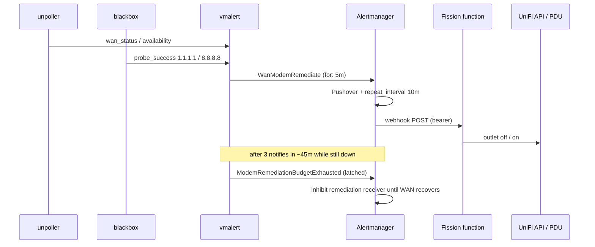

## Goal Capsule

**Objective:** When internet is sustained-down, automatically power-cycle the ISP modem/ONT on the UniFi PDU with enough confirmation and a hard attempt budget that saturation no longer causes repeated daily outages.

**Means:** Bump unpoller for WAN status metrics → composite VictoriaMetrics alert → Alertmanager (10m gap + 3-strike inhibit) → Fission HTTPTrigger → function that only power-cycles the modem outlet.

**Product authority:** Product Contract below. Planning Contract governs how.

**Open blockers:** None.

**Product Contract preservation:** unchanged.

## Product Contract

### Summary

Replace UniFi’s built-in “internet down → outlet” behavior with alert-stack-owned remediation policy and a thin Fission executor: dual-signal sustained WAN-down detection, a 10-minute minimum gap between cycles, and a circuit breaker that stops after three cycles by inhibiting via a synthetic alert visible in Alertmanager/Karma. The Fission function does not decide whether to remediate—it only runs the UniFi PDU power-cycle when Alertmanager invokes it.

### Problem Frame

UniFi’s outlet power-cycle thresholds treat brief WAN saturation as outages and reboot the modem repeatedly. The UDM and LAN stay up during those events; the needed behavior is a longer sustain window, an external confirmation signal, and a hard stop after a few failed self-heals—not a more sensitive controller feature. A custom webhook-to-Job shim would reimplement what Fission’s HTTPTrigger already provides in this cluster.

### Key Decisions

- **Remediate the ISP modem/ONT outlet, not the UDM Pro** — LAN and the UniFi API remain reachable during the cycle. `(session-settled: user-directed — chosen over UDM reboot: keep controller reachable)` — Governs R1, R8.
- **Alertmanager owns policy; Fission owns execution only** — AM delivers via webhook to an existing-style Fission `HTTPTrigger`; no custom shim and no one-shot Job. `(session-settled: user-directed — chosen over webhook-shim→Job: avoid rewriting Fission)` — Governs R6, R7, R10.
- **Composite alert owns “should remediate”** — UniFi WAN down and at least one external probe failing for a continuous 5m. `(session-settled: user-approved — chosen over UniFi-only or executor-side AND: fewer false cycles)` — Governs R2, R3.
- **Circuit breaker via inhibit + budget-exhausted alert in the alert stack** — gap via AM route timing; stop-after-N via inhibit. Function does not implement backoff/breaker branching. `(session-settled: user-directed — chosen over executor-side exponential backoff or Job-private state: keep policy in AM)` — Governs R4, R5, R9.
- **Trip after 3 cycles; ≥10m between cycles while closed** — `(session-settled: user-directed — chosen over 2/5 attempts and 15/30m gaps)` — Governs R4, R5.

### Actors

- **Operator** — receives Pushover for WAN-down and budget-exhausted; may clear or investigate when the breaker opens.
- **VictoriaMetrics / vmalert** — evaluates sustained dual-signal condition and budget-exhausted from cycle evidence.
- **Alertmanager** — human notify; remediation webhook route; `repeat_interval` / grouping for the 10m gap; inhibits remediation when budget-exhausted fires.
- **Fission router + HTTPTrigger** — receives the AM webhook (same pattern as `ics-proxy`).
- **Remediation function** — executes the UniFi PDU modem-outlet power-cycle only when invoked.
- **UniFi UDM Pro + PDU** — source of WAN status (via unpoller scrape) and outlet control target.

### Key Flows

**F1. Successful self-heal**

1. UniFi reports WAN down and an external probe fails continuously for 5m → composite alert fires.
2. Alertmanager notifies Pushover and, with breaker closed and gap elapsed, POSTs to the Fission HTTPTrigger.
3. Function power-cycles the modem outlet (execution only).
4. WAN recovers → composite alert resolves; budget-exhausted (if any) clears; attempt budget resets.

**F2. Breaker trips**

1. Same as F1 for three cycles with WAN still down, spaced by AM’s ≥10m remediation cadence.
2. After the third unsuccessful cycle, budget-exhausted alert fires in the alert stack.
3. Inhibit rule suppresses the remediation webhook route; Pushover still surfaces budget-exhausted / WAN-down as configured.
4. No further PDU cycles until WAN recovers and state resets (per R5).

**F3. Policy blocks invocation**

1. Composite condition is still true, but AM does not deliver to the remediation webhook (inside `repeat_interval`, or inhibited by budget-exhausted).
2. Function is not invoked; no outlet action.

### Requirements

**Detection**

- R1. The remediator power-cycles only the ISP modem/ONT PDU outlet, never the UDM Pro.
- R2. Remediation is eligible only when UniFi WAN status indicates down **and** at least one configured external probe is failing, both sustained for a continuous **5 minutes**.
- R3. Eligibility is expressed as a single composite alert (or equivalent recording-rule + alert) so Alertmanager only invokes remediation when both signals agree.

**Circuit breaker (Alertmanager / metrics)**

- R4. While the breaker is closed, Alertmanager does not invoke the remediation webhook more often than once per **10 minutes** for the same outage (route `repeat_interval` / grouping).
- R5. After **3** remediation cycles in one outage without WAN recovery, the alert stack fires a budget-exhausted alert that **inhibits** further remediation webhooks until WAN recovers, at which point the budget resets.
- R9. Budget-exhausted (and thus “why we stopped”) is visible in Alertmanager/Karma via the inhibit source alert.

**Action path (Fission)**

- R6. Alertmanager delivers remediation via webhook to a Fission **HTTPTrigger** (cluster-internal), not a custom Job-creating shim.
- R7. The Fission function’s responsibility is the UniFi API outlet power-cycle when invoked; it must not implement dual-signal checks, gap logic, or breaker open/closed branching.
- R8. During a cycle, the UDM and cluster remain the control plane (modem is the disrupted device).
- R10. Fission executor/environment retries (cold-start, failed invocation) are not used as remediation spacing or attempt budget; those are owned by R4 and R5.

**Notify**

- R11. Human notification (existing Pushover path) remains for WAN-down and budget-exhausted; the remediation webhook route is action-only and must not replace operator paging.

### Acceptance Examples

- AE1. When UniFi WAN flaps during saturation but external probes stay up, the composite alert does not fire and the function is not invoked. Covers R2, R3.
- AE2. When both signals are down for 5 continuous minutes and the breaker is closed with ≥10m since the last remediation notify, AM invokes Fission once and the modem outlet is power-cycled. Covers R2–R4, R6–R8.
- AE3. When the composite alert remains firing 5m after a cycle, AM does not re-invoke the function (gap). Covers R4, F3.
- AE4. When three cycles have run in one outage without WAN recovery, budget-exhausted fires, inhibit stops further remediation webhooks, and Pushover still informs the operator. Covers R5, R9, R11, F2.
- AE5. When WAN recovers after a tripped breaker, budget resets and a later sustained dual-signal outage can remediate again from attempt zero. Covers R5, F1.
- AE6. When AM is inhibited, a manual or stray call is out of band; under normal AM→Fission flow the function never decides to no-op for policy reasons. Covers R7.

### Success Criteria

- Sustained true WAN loss results in at most three modem power-cycles before human intervention is required.
- Saturation / brief UniFi WAN flaps without external probe failure do not cause modem cycles.
- An operator can see in Alertmanager/Karma whether remediation is active or budget-inhibited without reading Fission logs first.
- No new long-lived “Job factory” service is introduced; remediation execution reuses Fission.

### Scope Boundaries

**In scope:** Unpoller bump for WAN status metrics; detection wiring (metrics/alerts); Alertmanager route + `repeat_interval` + inhibit; Fission HTTPTrigger + function for UniFi PDU cycle; Pushover coexistence.

**Out of scope:** Custom webhook→Job shim; power-cycling the UDM; Robusta/Keep/StackStorm; Home Assistant as remediator; exponential remediation backoff in Fission executors/environments; changing UniFi’s built-in outlet feature beyond disabling/replacing its use for this outlet; general blackbox estate redesign; putting policy (AND, gap, breaker) inside the function.

### Dependencies / Assumptions

- Cluster can reach `https://unifi` on LAN while the modem is down or rebooting.
- A dedicated UniFi credential (or reuse of an existing secret pattern) can call the outlet power-cycle API.
- Fission router is reachable in-cluster as an Alertmanager webhook URL (same platform as `kubernetes/apps/fission/functions/ics-proxy/`).
- Unpoller major bump (3.x → 5.x) is acceptable for this feature; implementer validates scrape health after upgrade.

### Outstanding Questions

**Deferred to implementation**

- Exact PDU MAC and outlet index (1Password / ExternalSecret values).
- Pin unpoller image digest for the chosen ≥5.7.0 tag via renovate/digest update.
- Confirm primary WAN label (`wan_networkgroup` / device `name`) after scrape so PromQL can target the ISP uplink only.

## Planning Contract

### Key Technical Decisions

- KTD1. **Bump unpoller to ≥ v5.7.0** so UniFi WAN down uses `unpoller_device_wan_status` / availability metrics, not site `www` health. `(session-settled: user-directed — chosen over www-subsystem-only on v3.3.1: richer WAN status)` — Governs R2.
- KTD2. **Budget-exhausted from Alertmanager notification counts** — trip when `increase(alertmanager_notifications_total{receiver="<remediation-receiver>"}[45m]) >= 3` while dual-signal still holds; **latch open** with `ALERTS{alertname="ModemRemediationBudgetExhausted",alertstate="firing"}` so the breaker does not auto-close when the sliding window ages out; clear only when dual-signal recovers. Function emits no cycle counter. `(session-settled: user-directed — chosen over function-emitted cycle metrics: keep function execution-only; latch added so 45m is trip window only, not auto-reset)` — Governs R5, R7, R9.
- KTD3. **External confirmation = ICMP to 1.1.1.1 and 8.8.8.8** via new blackbox `VMProbe`s; composite requires at least one `probe_success == 0`. — Governs R2, R3.
- KTD4. **Cluster-only Fission HTTPTrigger** — AM posts to `http://router.fission.svc.cluster.local/<path>` (or the chart’s router Service DNS); no Gateway / public route. — Governs R6.
- KTD5. **PDU cycle via classic UniFi Network API** `outlet_overrides` (off → wait → on) against the USP PDU Pro; credentials + MAC + outlet index from ExternalSecret / 1Password. — Governs R1, R7, R8.
- KTD6. **Webhook auth** — AM `http_config.authorization` bearer token; function rejects missing/wrong token (same idea as `ics-proxy`). — Governs R6.

### High-Level Technical Design

```mermaid
stateDiagram-v2
  [*] --> Closed: WAN up / budget clear
  Closed --> Cycling: WanModemRemediate fires
  Cycling --> Closed: cycle done, attempts less than 3
  Cycling --> Open: 3rd remediation notify
  Open --> Open: still down (latch; 45m window aging does not close)
  Open --> Closed: WAN dual-signal clears
  Closed --> Closed: within repeat_interval: no webhook
```

### Assumptions

- v5.7.0+ `unpoller_device_wan_status` (1=online, 0=other) is the UniFi half of R2; refine labels after first scrape if multiple WANs exist.
- `alertmanager_notifications_total` is scraped for the in-cluster Alertmanager; receiver name in PromQL matches the new remediation receiver.
- Budget trip uses a 45m notify lookback, but the open state is latched via `ALERTS` until dual-signal clears — aging of the lookback alone must not re-enable remediation mid-outage.
- UniFi built-in outlet internet-down automation for this outlet is disabled (or never enabled) so it does not race this remediator.

### System-Wide Impact

- Unpoller major version bump may change other UniFi dashboard metric names; verify Grafana UniFi dashboards after U1.
- New critical alerts and an AM route that can power-cycle hardware—operators should know budget-exhausted means “stopped auto-healing.”

### Implementation Units Overview

| ID | Unit | Depends on |
|----|------|------------|
| U1 | Bump unpoller for WAN status metrics | — |
| U2 | External ICMP WAN probes | — |
| U3 | Composite + budget-exhausted VMRules | U1, U2 |
| U4 | Alertmanager remediation route + inhibit | U3 |
| U5 | Fission modem PDU cycle function | U3 |

## Implementation Units

### U1. Bump unpoller for WAN status metrics

**Goal:** Export UniFi per-WAN status/availability so R2 can use controller WAN state.

**Requirements:** R2

**Dependencies:** None

**Files:**
- Modify: `kubernetes/apps/observability/unpoller/app/helmrelease.yaml`

**Approach:**
1. Bump `ghcr.io/unpoller/unpoller` from v3.3.1 to **≥ v5.7.0** (prefer latest with `wan_status` / `wan_availability_percent`).
2. Keep existing env/secret pattern unless the 5.x chart/image requires new vars—adjust only if the pod fails.
3. After apply, confirm series `unpoller_device_wan_status` (and related) appear in VictoriaMetrics.

**Patterns to follow:** Existing unpoller HelmRelease + ExternalSecret `unpoller`.

**Test scenarios:**
- Happy path: after upgrade, query returns at least one `unpoller_device_wan_status` sample for the UDM.
- Error path: if scrape fails or metrics absent, do not proceed to U3 until fixed.
- Test expectation for pure image bump config: none beyond live metric presence check — reason: no new app code.

**Verification:**
- `kubectl`/VM UI shows healthy unpoller scrape and WAN status metrics.

---

### U2. External ICMP WAN probes

**Goal:** Provide the external half of the dual-signal (R2).

**Requirements:** R2, R3

**Dependencies:** None (parallel with U1)

**Files:**
- Create: `kubernetes/apps/observability/blackbox-exporter/probes/wan.yaml` (or equivalent name)
- Modify: `kubernetes/apps/observability/blackbox-exporter/probes/kustomization.yaml`

**Approach:**
1. Add `VMProbe` module `icmp`, interval ≤1m, targets `1.1.1.1` and `8.8.8.8`, labels suitable for joining in PromQL (e.g. `namespace: observability`, `probe: wan-external`).
2. Mirror structure of `probes/devices.yaml`.

**Patterns to follow:** `kubernetes/apps/observability/blackbox-exporter/probes/devices.yaml`

**Test scenarios:**
- Happy path: both targets show `probe_success` 0 or 1 in metrics.
- Covers AE1 partial: when probes succeed, they do not alone fire remediation.
- Test expectation: none for YAML-only probe config beyond live scrape — reason: no app code.

**Verification:**
- Blackbox / VM shows icmp probes to both IPs.

---

### U3. Composite WanModemRemediate + budget-exhausted VMRules

**Goal:** Encode dual-signal sustain (5m) and 3-notify budget alert for inhibit.

**Requirements:** R2, R3, R5, R9

**Dependencies:** U1, U2

**Files:**
- Create: e.g. `kubernetes/apps/network/modem-remediation/app/vmrule.yaml` (or under observability—prefer a small `modem-remediation` app folder if that matches repo taste; otherwise co-locate under blackbox/unpoller)
- Create: supporting `kustomization.yaml` / `ks.yaml` as needed to Flux-wire the rules

**Approach:**
1. Alert `WanModemRemediate` (severity critical): UniFi WAN down **and** `min(probe_success{…wan-external…}) == 0`, `for: 5m`. Use `unpoller_device_wan_status == 0` (or `max by (…) == 0` for primary WAN) once labels are confirmed from U1.
2. Alert `ModemRemediationBudgetExhausted`: `(increase(...[45m]) >= 3 or ALERTS{alertname=ModemRemediationBudgetExhausted,alertstate=firing})` **and** the same dual-signal condition (no extra `for`), so it trips on the third notify, stays open while still down (latch), and clears only when WAN recovers. Per KTD2.
3. Annotations suitable for Pushover (summary/description).

**Patterns to follow:** `kubernetes/apps/observability/blackbox-exporter/app/vmrule.yaml`; `kubernetes/components/vmrule/` job labeling.

**Test scenarios:**
- Covers AE1. UniFi flaps, probes up → composite does not fire.
- Covers AE2. Both down 5m → composite fires.
- Covers AE4/AE5. Three remediation notifies while still down → budget alert; WAN recovery clears budget.
- Edge: only one of two ICMP targets down → still satisfies “at least one” (R2).

**Verification:**
- Temporarily force expressions or use recording stubs in a dry-run review; confirm rule YAML loads in vmalert.

---

### U4. Alertmanager remediation route + inhibit

**Goal:** 10m gap, Pushover coexistence, webhook to Fission, inhibit on budget.

**Requirements:** R4, R5, R6, R9, R11

**Dependencies:** U3 (alert names). Webhook path is fixed by convention (`/modem-pdu-cycle` on the Fission router Service); U5 implements that path.

**Files:**
- Modify: `kubernetes/apps/observability/victoria-metrics/app/vmalertmanagerconfig.yaml`
- Modify: `kubernetes/apps/observability/victoria-metrics/app/externalsecret.yaml` (bearer token for webhook)

**Approach:**
1. Add receiver `modem-pdu-cycle` with `webhook_configs` → Fission router URL + bearer from secret (KTD4, KTD6).
2. Route: match `alertname=WanModemRemediate`, `receiver: modem-pdu-cycle`, `group_wait: 0s`, `repeat_interval: 10m`, continue or parallel route so **Pushover still receives** WanModemRemediate (either `continue: true` to pushover or duplicate matchers)—must satisfy R11.
3. `inhibit_rules`: source `ModemRemediationBudgetExhausted` inhibits target `WanModemRemediate` for the remediation webhook path (and optionally silence noise). Ensure Pushover still gets budget-exhausted.
4. Budget-exhausted routes to Pushover only (no webhook).

**Patterns to follow:** Existing `heartbeat` webhook + `pushover` receivers in the same file.

**Test scenarios:**
- Covers AE3. Second notify inside 10m does not hit webhook (`repeat_interval`).
- Covers AE4. When budget alert fires, remediation webhook stops; Pushover still alerts.
- Auth: AM sends bearer; wrong token is a U5 concern.

**Verification:**
- AM config reload; Karma shows routes; optional test alert without cycling hardware (mock URL) before pointing at Fission.

---

### U5. Fission modem PDU cycle function

**Goal:** Execution-only UniFi PDU power-cycle when AM calls.

**Requirements:** R1, R6, R7, R8, R10

**Dependencies:** U3 (feature exists to call). Align bearer secret and path with U4 (`/modem-pdu-cycle`); U4 and U5 may land in either order.

**Files:**
- Create: `kubernetes/apps/fission/functions/modem-pdu-cycle/` (`main.py`, `unifi_pdu.py` or similar, `pyproject.toml`, `package.yaml`, `function.yaml`, `trigger.yaml`, `externalsecret.yaml`, `kustomization.yaml`)
- Modify: `kubernetes/apps/fission/functions/kustomization.yaml`

**Approach:**
1. HTTPTrigger `POST` relative URL (e.g. `/modem-pdu-cycle`), **no** Gateway `routeConfig` (cluster-only).
2. Function: validate bearer; load UniFi URL/user/pass (or API key), PDU MAC, outlet index from `/secrets/fission/...`; call classic API to set `outlet_overrides` relay off, sleep briefly, set on (KTD5).
3. No PromQL, no attempt counter, no “should I cycle?” branching (R7 / KTD2).
4. Return 2xx on success so AM does not endlessly retry delivery backoff for a completed cycle; 5xx only for true failures worth AM retry.
5. Unit-test PDU override merge logic with fixtures (no live UniFi required).

**Patterns to follow:** `kubernetes/apps/fission/functions/ics-proxy/` (package literal zip, ExternalSecret, poolmgr, python-fastapi env).

**Test scenarios:**
- Happy path: valid auth + mocked UniFi client → off then on called for configured outlet index.
- Covers AE6. Function does not skip based on WAN/budget state.
- Error: missing/invalid bearer → 401, no UniFi calls.
- Error: UniFi API failure → 5xx, no partial “stuck off” without best-effort restore if off already sent (document best-effort re-on in approach comments).
- Edge: preserve sibling `outlet_overrides` entries when patching one index.

**Verification:**
- pytest (or equivalent) in the function package for override merge + auth.
- Manual: AM test webhook or curl from a debug pod with bearer → outlet cycles once.

**Execution note:** Prefer test-first on the UniFi override helper before wiring the live trigger.

## Verification Contract

- Confirm unpoller ≥5.7.0 scrapes `unpoller_device_wan_status`.
- Confirm ICMP probes for 1.1.1.1 / 8.8.8.8.
- Confirm `WanModemRemediate` and `ModemRemediationBudgetExhausted` load in vmalert.
- Confirm AM route: 10m repeat, inhibit, Pushover still fires, webhook authenticated to Fission.
- Confirm Fission function unit tests pass; one controlled live cycle in a maintenance window.
- Confirm UniFi controller’s own outlet internet-down action for that port is off.

## Definition of Done

- All U1–U5 merged via GitOps and healthy in-cluster.
- AE1–AE6 satisfied by alerts + one supervised live cycle (or documented dry-run + mocked U5 if live cycle deferred).
- Operator can see WanModemRemediate vs ModemRemediationBudgetExhausted in Karma/Alertmanager.
- No custom Job/shim Deployment introduced.
